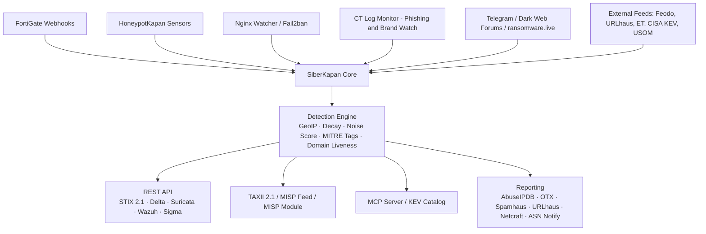

[Türkçe](README.tr.md) · **English**

# SiberKapan

**Turkey's Open-Source Cyber Threat Intelligence Platform**

[](LICENSE)
[]()
[](https://siberkapan.org/api/v1/status)
[](https://siberkapan.org/misp-feed/manifest.json)
[](https://siberkapan.org/taxii/)
[](https://siberkapan.org/rss/cve)
[](https://doi.org/10.5281/zenodo.22086120)

> **Official MISP Default Feed:** SiberKapan's threat intelligence feed has been officially merged into the default feed list of MISP (Malware Information Sharing Platform), the open source threat intelligence platform used by CERTs, SOCs and government cybersecurity teams worldwide.

SiberKapan is a threat intelligence platform focused on cyber threats targeting Turkish infrastructure. It collects threat data from its own sensor network of FortiGate webhooks, honeypot sensors, Nginx log analysis and Fail2ban, supplemented by trusted external feeds. It detects phishing and malicious domains in real time through Certificate Transparency log monitoring, and tracks ransomware leak sites, Telegram channels and dark web forums for Turkey-related activity. Results are published as ready-to-use blocklists, STIX 2.1 bundles, TAXII 2.1 endpoints, a REST API and an MCP server for AI assistants.

**Live Platform:** [https://siberkapan.org](https://siberkapan.org)
**API Status:** [https://siberkapan.org/api/v1/status](https://siberkapan.org/api/v1/status)
**Methodology:** [https://siberkapan.org/methodology](https://siberkapan.org/methodology)
**Threat Reports:** [https://siberkapan.org/tehdit-raporlari](https://siberkapan.org/tehdit-raporlari)
**Developed and operated by:** [ADEA Sistem Bilgi Teknolojileri](https://www.adeasis.com/), Istanbul

---

## Recognition & Ecosystem Integration

| Platform | Status | Details |
|----------|--------|---------|
| **MISP** | Official default feed | Feed PR merged, [manifest](https://siberkapan.org/misp-feed/manifest.json) |
| **MISP Modules** | Expansion module merged | SiberKapan IP lookup module, [MISP/misp-modules #1095](https://github.com/MISP/misp-modules/pull/1095) |
| **GCVE KEV Directory** | Listed | SiberKapan KEV catalog, [gcve-eu/gcve.eu-directory #3](https://github.com/gcve-eu/gcve.eu-directory/pull/3) |
| **Vulnerability-Lookup** | Sightings contributor | Daily vulnerability sightings |
| **AbuseIPDB** | Webmaster & Contributor | Active IP reporting |
| **AlienVault OTX** | Pulse publisher | Daily IOC pulses |
| **Spamhaus** | Submission partner | Active IP reporting |
| **abuse.ch URLhaus** | Submitter | Malicious URL reporting |
| **Netcraft** | Reporter | Automatic phishing reporting |
| **Zenodo** | DOI | [10.5281/zenodo.22086120](https://doi.org/10.5281/zenodo.22086120) |
| **TAXII 2.1** | Live | [https://siberkapan.org/taxii/](https://siberkapan.org/taxii/) |
| **Suricata IDS** | Export | `/api/v1/export/suricata` |
| **Wazuh SIEM** | Export | `/api/v1/export/wazuh-cdb` |
| **TR Presidential Cybersecurity Cluster** | Member | Cumhurbaşkanlığı DDO Siber Güvenlik Kümesi |

---

## Features

### Collection and detection

- **FortiGate Automation Stitch Integration.** Real-time attacker IP submission via webhook from FortiGate Security Fabric.
- **Phishing & Malicious Domain Detection.** Real-time Certificate Transparency (CT) log monitoring catches phishing domains at certificate-issuance time, often before any complaint is filed. Combines brand and intent keyword matching, fuzzy typosquat detection and Punycode/IDN decoding. See [Detection Methodology](docs/PHISHING_DETECTION.md).
- **HoneypotKapan.** Open-source honeypot emulating 11 services (SSH, RDP, FTP, Telnet, SMB, MySQL, MSSQL, VNC, HTTP, SIP, SMTP), one-command install.
- **Malware Sample Capture.** The SSH honeypot safely fingerprints malware attackers try to download (SHA256, SSRF-protected, never written to disk or executed), enriched via MalwareBazaar. See [siberkapan.org/malware-samples](https://siberkapan.org/malware-samples).
- **Nginx Watcher.** Zero-dependency Python agent detecting 404, auth and rate floods and exploit signatures from nginx access logs.
- **Fail2ban Integration.** Automated ban event reporting.
- **Domain Liveness Tiering.** Own-source and USOM-sourced domains are continuously re-verified via tiered DNS/HTTP sweeps, separating active threats from long-dead entries that official lists never prune.

### Analysis

- **Noise Score.** Helps separate mass internet scanning noise from more targeted activity for each IP.
- **IP Timeline, Attack Chain and Risk Factors.** The IP detail page shows an activity timeline, an attack-chain card and the factors behind the score.
- **Behaviour Tags (MITRE ATT&CK).** Detections are tagged by behaviour and mapped to MITRE ATT&CK, with trend views. See [/tags](https://siberkapan.org/tags).
- **Attack Frequency.** Attack volume and frequency over time. See [/attack-frequency](https://siberkapan.org/attack-frequency).
- **Turkey Threat Map.** Per-network (ASN) view of attack sources located in Turkey. See [/tr-tehdit-haritasi](https://siberkapan.org/tr-tehdit-haritasi).
- **Top Passwords.** Weekly list of the passwords most tried against the honeypots. See [/top-passwords](https://siberkapan.org/top-passwords).
- **Unified Search.** A single search box across the platform's data. See [/search](https://siberkapan.org/search).

### Vulnerability intelligence

- **KEV Catalog.** SiberKapan's own known-exploited-vulnerabilities catalog (`kev.json`, CC BY 4.0), also published in GCVE BCP-07 format and listed in the GCVE KEV directory. See [/kev-catalog](https://siberkapan.org/kev-catalog).
- **Vulnerability-Lookup Sightings.** Daily sightings pushed to Vulnerability-Lookup.
- **CVE Feed.** 1,600+ CISA KEV records with vendor-filtered RSS.

### Monitoring

- **Ransomware Turkey.** Turkey-related victims on ransomware leak sites, based on ransomware.live data. See [/ransomware-turkey](https://siberkapan.org/ransomware-turkey).
- **Telegram Monitoring.** Around 400 threat-related Telegram channels (from the deepdarkCTI list) monitored over Tor.
- **Dark Web Forum Monitoring.** Post titles and links from selected forums collected over Tor. Post content and files are not downloaded.
- **Brand Watch.** Alerts when CT logs show a look-alike domain for a watched brand. See [/brand-watch](https://siberkapan.org/brand-watch).
- **Network Watch.** Domain owners get alerts when their domain shows up in Telegram channels, threat domain feeds, forum titles or XposedOrNot breach data. See [/network-watch](https://siberkapan.org/network-watch).
- **Leak Check.** Domain-level exposure report from authorized OSINT sources. The report is emailed only to an address on the queried domain. See [/leak-check](https://siberkapan.org/leak-check).
- **Daily Intel Digest.** Daily summary email.

### Sharing and integration

- **MISP Official Feed.** STIX-compatible JSON feed, accepted into the MISP ecosystem.
- **MISP Expansion Module.** SiberKapan IP lookup, merged into MISP/misp-modules.
- **MCP Server.** Lets AI assistants query SiberKapan directly. See [/ai-integration](https://siberkapan.org/ai-integration).
- **TAXII 2.1 Server.** Standard protocol for enterprise SIEM/SOAR integration (Anomali, ThreatConnect, CERT platforms).
- **Delta / Incremental Feed.** `?since=` parameter and ETag support to reduce bandwidth.
- **Blocklists.** TXT, JSON, CIDR, /24 network-block, FortiGate CLI, iptables, Suricata rules and Wazuh CDB formats.
- **Sigma Rule Export.** SIEM-agnostic detection rules (`/api/v1/export/sigma`) for Splunk, Elastic, Sentinel and QRadar via pySigma.
- **STIX 2.1 Output.** Machine-readable threat intelligence bundle.
- **BGP / IP Lookup.** ASN, GeoIP, threat score and source attribution.
- **ASN Abuse Notification.** Automatic weekly abuse reports to network operators (Shadowserver model).
- **AbuseIPDB / OTX / Spamhaus / URLhaus / Netcraft Reporting.** Active contribution to global threat databases.
- **IP & Domain Aging.** Automatic score decay and delisting for inactive IPs. Dead domains age out of active monitoring.
- **IP Delisting.** False positive reporting with Cloudflare Turnstile protection.
- **TR/EN Bilingual.** Full Turkish and English interface.
- **Threat Reports.** Monthly automated Turkey server attack reports and periodic in-depth reports.

---

## Architecture



---

## Quick Start: FortiGate Integration

Add SiberKapan to your FortiGate in 5 minutes.

**1. Create Automation Action (Webhook)**

```
Name: SiberKapan
Protocol: HTTPS
URL: https://siberkapan.org/feed/fortigate
Method: POST
Header: X-SiberKapan-Key: <your-api-key>
Header: Content-Type: application/json
```

**HTTP Body:**
```json
{
  "ip": "%%log.srcip%%",
  "attack_type": "%%log.attack%%",
  "port": %%log.dstport%%,
  "severity": "%%log.severity%%",
  "proto": "%%log.proto%%",
  "src_country": "%%log.srccountry%%",
  "device": "%%log.devname%%"
}
```

**2. Create Automation Stitch**
- Trigger: `IPS Event` or `Anomaly Logs`
- Action: The webhook action above

**3. Request an API Key**
Contact via [siberkapan.org/iletisim](https://siberkapan.org/iletisim).

---

## Quick Start: Honeypot & Nginx Watcher

| Agent | What It Detects | Install |
|-------|-----------------|---------|
| [HoneypotKapan](honeypot/) | SSH, RDP, FTP, Telnet, SMB, MySQL, MSSQL, VNC, HTTP, SIP, SMTP | `wget https://siberkapan.org/honeypot/install.py && sudo python3 install.py` |
| [Nginx Watcher](nginx-watcher/) | 404, auth and rate floods, exploit path signatures, scanner UAs | `curl -fsSL https://siberkapan.org/nginx-watcher/install.sh \| sudo bash -s -- --key=YOUR_KEY` |

---

## Phishing & Malicious Domain Detection

SiberKapan runs a dedicated real-time engine that catches phishing and malicious domains, often before official lists like USOM hear about them. It combines:

- **Certificate Transparency log monitoring.** Every new TLS certificate is seen the moment it is issued.
- **Brand & intent keyword matching.** Boundary-aware detection of impersonated institutions and common lure language.
- **Fuzzy typosquat detection.** Catches near-miss brand spellings.
- **Punycode/IDN decoding** and **cloud-infrastructure filtering** to cut noise.
- **Tiered DNS/HTTP liveness verification** to keep the feed free of stale, long-dead domains.

Full write-up of the detection pipeline: **[docs/PHISHING_DETECTION.md](docs/PHISHING_DETECTION.md)**

Want to help expand the keyword and pattern library? See **[docs/CONTRIBUTING_PATTERNS.md](docs/CONTRIBUTING_PATTERNS.md)**.

### Domain Feed Endpoints

| Endpoint | Description |
|----------|-------------|
| `/domains/txt` \| `/domains/json` | Combined domain feed (USOM and own-source), filterable by `source`/`type`/`min_criticality` |
| `/domains/siberkapan/txt` \| `/domains/siberkapan/json` | Own-source detections only (CT log and honeypot derived) |
| `/domains/usom-live/txt` \| `/domains/usom-live/json` | USOM's list filtered to domains SiberKapan has confirmed are still DNS-active |

---

## API Reference

### Feed Endpoints (Delta/ETag supported)

| Endpoint | Format | Description |
|----------|--------|-------------|
| `/api/v1/view/all-feed` | TXT | All sources combined, supports `?since=` |
| `/api/v1/view/fortigate-feed` | TXT | FortiGate feed, supports `?since=` |
| `/api/v1/view/honeypot-feed` | TXT | HoneypotKapan feed, supports `?since=` |
| `/api/v1/view/nginx-feed` | TXT | Nginx Watcher feed, supports `?since=` |

**Delta fetch example:**
```bash
# Only IPs added after a specific timestamp
curl "https://siberkapan.org/api/v1/view/all-feed?since=2026-07-01T00:00:00Z"

# ETag-based caching (returns 304 if unchanged)
curl -H "If-None-Match: \"sk-abc123\"" https://siberkapan.org/api/v1/view/all-feed
```

### Blocklist Export Endpoints

| Endpoint | Format | Description |
|----------|--------|-------------|
| `/api/v1/list/txt` | TXT | All approved IPs, plaintext |
| `/api/v1/list/json` | JSON | Full IP data with metadata |
| `/api/v1/list/cidr` | CIDR | CIDR notation |
| `/api/v1/list/fortigate` | TXT | FortiGate CLI format |
| `/api/v1/list/iptables` | SH | iptables bash script |
| `/api/v1/export/suricata` | rules | Suricata IDS drop/alert rules |
| `/api/v1/export/wazuh-cdb` | CDB | Wazuh SIEM CDB list |
| `/api/v1/export/sigma` | YAML | Sigma detection rule (SIEM-agnostic) |

**Suricata integration:**
```bash
curl -o /etc/suricata/rules/siberkapan.rules \
  "https://siberkapan.org/api/v1/export/suricata?min_score=75"
```

**Wazuh integration:**
```bash
curl -o /var/ossec/etc/lists/siberkapan-blocklist \
  "https://siberkapan.org/api/v1/export/wazuh-cdb?min_score=75"
```

**Sigma integration:**
```bash
curl -o siberkapan.yml "https://siberkapan.org/api/v1/export/sigma?min_score=40"
```

### TAXII 2.1 Endpoints

| Endpoint | Description |
|----------|-------------|
| `/taxii/` | Discovery |
| `/taxii/api-root/` | API Root |
| `/taxii/api-root/collections/` | Collections list |
| `/taxii/api-root/collections/{id}/objects/` | STIX objects (supports `added_after`) |
| `/taxii/api-root/collections/{id}/manifest/` | Object manifest |

**Collections:**

| ID | Name | Description |
|----|------|-------------|
| `a1b2c3d4-0001-4000-8000-siberkapan01` | All Threats | All approved IPs |
| `a1b2c3d4-0002-4000-8000-siberkapan02` | High Risk | Score 75+ |
| `a1b2c3d4-0003-4000-8000-siberkapan03` | Honeypot | Honeypot detections |

```bash
# TAXII discovery
curl -H "Accept: application/taxii+json;version=2.1" https://siberkapan.org/taxii/

# Fetch STIX objects
curl "https://siberkapan.org/taxii/api-root/collections/a1b2c3d4-0001-4000-8000-siberkapan01/objects/?limit=100"
```

### MISP Feed

```
https://siberkapan.org/misp-feed/manifest.json
```

Add to MISP: Administration → Feeds → Add Feed → URL: `https://siberkapan.org/misp-feed/`

### MISP Expansion Module

The SiberKapan module is part of [MISP/misp-modules](https://github.com/MISP/misp-modules). Enable it under Administration → Server Settings → Plugin → Enrichment and use it to look up IP attributes against SiberKapan.

### CVE / Threat Intel

| Endpoint | Description |
|----------|-------------|
| `/api/v1/cve` | CISA KEV CVE records (JSON) |
| `/api/v1/cve?vendor=fortinet` | Vendor-filtered CVEs |
| `/rss/cve` | CVE RSS feed |
| `/rss/ioc` | IOC RSS feed |
| `/api/v1/stix` | STIX 2.1 bundle |
| `/api/v1/bgp/{ip}` | IP reputation & BGP lookup |
| `/api/v1/ip/{ip}` | IP threat intelligence lookup (JSON) |
| `/api/v1/status` | Platform status |

---

## Threat Scoring

| Source | Score Bump | Notes |
|--------|-----------|-------|
| FortiGate, critical | +40 | Verified API key, critical severity |
| FortiGate, high | +30 | Verified API key, high severity |
| FortiGate, medium | +20 | Verified API key, medium severity |
| FortiGate, low | +10 | Verified API key, low severity |
| External Feed | 50 | Initial score, source dependent |
| Bulk API | +15 | Batch submission |

Scores are cumulative (max 100). IPs decay at 2 points per day after 30 days of inactivity and are automatically delisted below score 15.

---

## Data Sources

| Source | Type | Update |
|--------|------|--------|
| FortiGate webhooks | Own sensor | Real-time |
| HoneypotKapan sensors | Own sensor | Real-time |
| Nginx Watcher agents | Own sensor | Real-time |
| Fail2ban reports | Own sensor | Real-time |
| Certificate Transparency logs (phishing, brand watch) | Own source | Real-time |
| Telegram channels (deepdarkCTI list, over Tor) | Monitoring | Scheduled |
| Dark web forum titles (over Tor) | Monitoring | Scheduled |
| [ransomware.live](https://www.ransomware.live) | Ransomware | Scheduled |
| [USOM domain list](https://siberguvenlik.gov.tr) | External | Hourly |
| [Feodo Tracker](https://feodotracker.abuse.ch) | External | 6h |
| [URLhaus](https://urlhaus.abuse.ch) | External | 6h |
| [Emerging Threats](https://rules.emergingthreats.net) | External | 12h |
| [CISA KEV](https://www.cisa.gov/known-exploited-vulnerabilities-catalog) | CVE | Daily |
| [MISP warninglists](https://github.com/MISP/misp-warninglists) | False positive filter | Daily |
| [RIPE NCC](https://stat.ripe.net) | Country prefixes | On demand |

---

## Security & Data Quality

Building a threat intelligence platform brings its own problems around data integrity, false positives and adversarial manipulation. SiberKapan addresses them systematically.

### IP Aging & Automatic Delisting

Threat scores are not permanent. An IP that was part of a botnet three months ago may now be assigned to a legitimate user. SiberKapan uses a time-based decay mechanism modeled on AbuseIPDB's scoring approach.

- **Grace period.** IPs with activity in the last 30 days do not decay.
- **Daily decay.** After the grace period, the threat score drops by 2 points per day.
- **Automatic delisting.** When a score drops below 15, the IP is removed from all feeds and blocklists, but the record is kept for audit purposes.
- **Natural reset.** Any new detection resets the decay counter, so persistent threats are not delisted early.
- **Implementation.** Decay runs as a bulk operation rather than row-by-row updates, which prevents lock contention under concurrent load.

### False Positive Prevention

**Infrastructure allowlisting.** CDN and cloud proxy infrastructure (Cloudflare, Fastly, AWS CloudFront, Google) is automatically excluded from threat feeds. When a reverse proxy sits in front of a monitored web server, naive log analysis would flag the proxy's edge nodes as attackers. SiberKapan cross-references detected IPs against the official CIDR ranges published by each provider, refreshed every 24 hours. IPs identified as infrastructure are tagged and excluded from feeds, novel detection calculations and AbuseIPDB reporting.

**MISP warninglists.** Selected [MISP warninglists](https://github.com/MISP/misp-warninglists) (known scanners and crawlers, reserved ranges, bank websites and similar) are applied daily to both IP and domain detections. Matching entries are withdrawn from the feeds.

**UDP spoofing protection.** UDP connections cannot be tied to a verified source IP, because the protocol is connectionless and source addresses can be spoofed. All UDP-only detections (UDP flood, UDP scan, session-based UDP anomalies) are kept internally for traffic analysis but are explicitly excluded from:
- All public feed endpoints
- AbuseIPDB submissions
- MISP feed events
- ASN abuse notifications

This matches AbuseIPDB's own reporting policy, which disallows UDP-based submissions for the same spoofing reason. The exclusion is enforced at the data pipeline level, not as a UI filter. UDP-only IPs cannot reach any external reporting channel, however the submission is triggered.

**Novel detection methodology.** The platform's "novel detection" metric (share of IPs not previously known to AbuseIPDB) is calculated only over IPs detected by SiberKapan's own sensors: honeypot, FortiGate, Nginx Watcher and Fail2ban. External feed aggregations (Feodo Tracker, URLhaus, Emerging Threats) are excluded, because they consist of already-known global threats and would artificially lower the metric.

**Phishing detection safeguards.** Domain detections whose entire signal is fuzzy-derived (no exact brand or intent match) are capped below the auto-approve threshold and sent to manual review. Coincidental substring collisions therefore cannot reach public feeds unsupervised. See [docs/PHISHING_DETECTION.md](docs/PHISHING_DETECTION.md).

### Data Poisoning & Abuse Prevention

**Source verification.** FortiGate webhook submissions require a pre-issued API key. The key is bound to a specific account and is used to attribute detections to a verified sensor. Unkeyed submissions are rejected.

**Private IP rejection.** RFC 1918 private address space (10.x.x.x, 172.16.x.x, 192.168.x.x) and loopback addresses are rejected at the ingestion layer. They cannot represent real external threats and are a common way to poison blocklists.

**Delisting with verification.** Delisting requests require a valid email address, pass Cloudflare Turnstile bot detection and are limited to 3 requests per 24 hours per submitter. All requests are reviewed manually and approved delistings are logged for audit purposes.

**Multi-source corroboration.** An IP detected by several independent sources (for example both a honeypot and a FortiGate sensor at a different organization) receives a higher confidence score. Single-source detections are scored conservatively.

### Malware Sample Handling

SiberKapan's SSH honeypot captures malware samples that attackers try to download, without ever storing or executing them.

- **SSRF protection.** The download URL's hostname is resolved and every returned address is validated as a public IP before any connection is made. Private, loopback, link-local and cloud-metadata addresses are rejected. The validated IP is connected to directly (not re-resolved), which prevents DNS-rebinding bypass.
- **No persistence.** The file is streamed, hashed (SHA256) and discarded. It is never written to disk and never executed.
- **Bounded fetch.** 5 MB size cap, 8-second timeout and at most 3 redirects, each validated again.
- **Enrichment, not storage.** Captured hashes are checked against [MalwareBazaar](https://bazaar.abuse.ch) to identify known malware families. SiberKapan never hosts the file itself.

### Monitoring Boundaries

- **Dark web forums.** Only post titles and links are collected. Post content, attachments and leaked files are not downloaded.
- **Leak Check.** Uses authorized OSINT sources and contains no plaintext passwords. Reports are emailed only to an address on the queried domain, so only the domain owner sees them.

---

- **Standards:** STIX 2.1, TAXII 2.1, RSS/Atom, REST, MCP
- **Integrations:** MISP, MISP Modules, AbuseIPDB, AlienVault OTX, Spamhaus, URLhaus, Netcraft, Vulnerability-Lookup, Suricata, Wazuh

---

## Threat Reports

Monthly automated Turkey server attack reports, plus periodic in-depth reports analyzing detection trends, novel threat discovery rates and attack patterns.

- All reports: [siberkapan.org/tehdit-raporlari](https://siberkapan.org/tehdit-raporlari)
- [Issue 1, June-July 2026](https://siberkapan.org/tehdit-raporlari/sayi-1) | [EN PDF](https://siberkapan.org/static/reports/siberkapan-tehdit-raporu-sayi1-en.pdf) | [TR PDF](https://siberkapan.org/static/reports/siberkapan-tehdit-raporu-sayi1-tr.pdf)

---

## IP Delisting

If you believe your IP has been listed by mistake:
[https://siberkapan.org/delist](https://siberkapan.org/delist)

Every request is reviewed within 48 hours. Bot protection via Cloudflare Turnstile.

---

## License

MIT License. See [LICENSE](LICENSE) for details.

---

## Contact

- **Platform:** [siberkapan.org](https://siberkapan.org)
- **Contact Form:** [siberkapan.org/iletisim](https://siberkapan.org/iletisim)
- **Developer:** [Oktay ALVER](https://www.linkedin.com/in/oktayalver/)
- **Company:** [ADEA Sistem Bilgi Teknolojileri](https://www.adeasis.com/)
