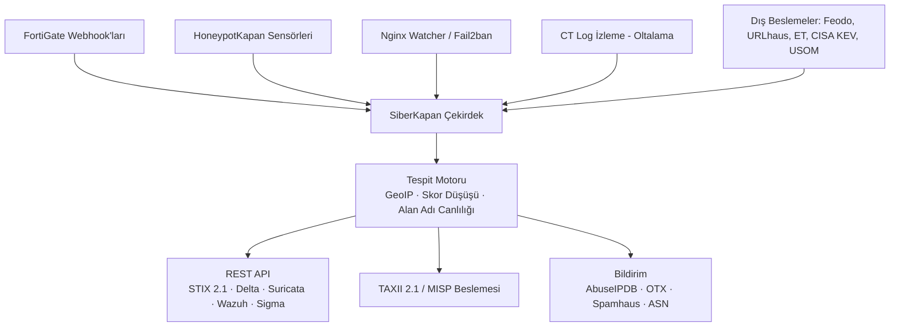

**Türkçe** · [English](README.md)

# SiberKapan

**Türkiye'nin Açık Kaynak Siber Tehdit İstihbaratı Platformu**

[](LICENSE)
[]()
[](https://siberkapan.org/api/v1/status)
[](https://siberkapan.org/misp-feed/manifest.json)
[](https://siberkapan.org/taxii/)
[](https://siberkapan.org/rss/cve)
[](https://doi.org/10.5281/zenodo.22086120)

> **Resmi MISP Varsayılan Beslemesi:** SiberKapan'ın tehdit istihbaratı beslemesi, dünya genelinde CERT'lerin, SOC'ların ve kamu siber güvenlik ekiplerinin kullandığı açık kaynak tehdit istihbaratı platformu MISP'in (Malware Information Sharing Platform) varsayılan besleme listesine resmi olarak eklenmiştir.

SiberKapan, Türkiye altyapısını hedefleyen siber tehditlere odaklanan bir tehdit istihbaratı platformudur. Tehdit verisini kendi sensör ağından toplar. Bu ağ FortiGate webhook'ları, honeypot sensörleri, Nginx log analizi ve Fail2ban kayıtlarından oluşur, güvenilir dış beslemelerle desteklenir. Certificate Transparency log izlemesiyle oltalama ve zararlı alan adlarını gerçek zamanlı tespit eder. Sonuçları kullanıma hazır engelleme listeleri, STIX 2.1 paketleri, TAXII 2.1 uç noktaları ve REST API olarak yayınlar.

**Canlı Platform:** [https://siberkapan.org](https://siberkapan.org)
**API Durumu:** [https://siberkapan.org/api/v1/status](https://siberkapan.org/api/v1/status)
**Metodoloji:** [https://siberkapan.org/metodoloji](https://siberkapan.org/metodoloji)
**Tehdit Raporları:** [https://siberkapan.org/tehdit-raporlari](https://siberkapan.org/tehdit-raporlari)
**Geliştiren ve işleten:** [ADEA Sistem Bilgi Teknolojileri](https://www.adeasis.com/), İstanbul

---

## Tanınırlık ve Ekosistem Entegrasyonları

| Platform | Durum | Ayrıntı |
|----------|-------|---------|
| **MISP** | Resmi besleme | Besleme PR'ı kabul edildi, [manifest](https://siberkapan.org/misp-feed/manifest.json) |
| **AbuseIPDB** | Webmaster ve Contributor | Aktif IP bildirimi |
| **AlienVault OTX** | Pulse yayıncısı | Günlük IOC pulse'ları |
| **Spamhaus** | Bildirim ortağı | Aktif IP bildirimi |
| **TAXII 2.1** | Canlı | [https://siberkapan.org/taxii/](https://siberkapan.org/taxii/) |
| **Suricata IDS** | Dışa aktarım | `/api/v1/export/suricata` |
| **Wazuh SIEM** | Dışa aktarım | `/api/v1/export/wazuh-cdb` |
| **Cumhurbaşkanlığı Siber Güvenlik Kümelenmesi** | Üye | Cumhurbaşkanlığı DDO Siber Güvenlik Kümesi |

---

## Özellikler

- **FortiGate Automation Stitch Entegrasyonu.** FortiGate Security Fabric'ten webhook ile gerçek zamanlı saldırgan IP bildirimi.
- **Oltalama ve Zararlı Alan Adı Tespiti.** Gerçek zamanlı Certificate Transparency (CT) log izlemesi, oltalama alan adlarını sertifika verildiği anda, çoğu zaman henüz hiçbir şikâyet yapılmadan yakalar. Marka ve niyet anahtar kelimesi eşleştirmesi, bulanık typosquat tespiti ve Punycode/IDN çözümlemesini birleştirir. Bkz. [Tespit Metodolojisi](docs/PHISHING_DETECTION.md)
- **HoneypotKapan.** 11 servisi (SSH, RDP, FTP, Telnet, SMB, MySQL, MSSQL, VNC, HTTP, SIP, SMTP) taklit eden açık kaynak honeypot, tek komutla kurulur.
- **Zararlı Yazılım Örneği Yakalama.** SSH honeypot'u, saldırganların indirmeye çalıştığı zararlı yazılımların parmak izini güvenli şekilde alır (SHA256, SSRF korumalı, diske yazılmaz ve çalıştırılmaz). MalwareBazaar ile zenginleştirilir. Bkz. [siberkapan.org/malware-samples](https://siberkapan.org/malware-samples)
- **Alan Adı Canlılık Katmanları.** Kendi kaynağımızdan ve USOM'dan gelen alan adları katmanlı DNS/HTTP taramalarıyla sürekli yeniden doğrulanır. Böylece gerçekten aktif tehditler, resmi listelerin hiç temizlemediği ölü kayıtlardan ayrılır.
- **Sigma Kuralı Dışa Aktarımı.** pySigma ile Splunk, Elastic, Sentinel ve QRadar için SIEM'den bağımsız tespit kuralları (`/api/v1/export/sigma`).
- **Nginx Watcher.** Nginx erişim loglarından 404, kimlik doğrulama ve istek selleri ile istismar imzalarını tespit eden, bağımlılığı olmayan Python ajanı.
- **Fail2ban Entegrasyonu.** Engelleme olaylarının otomatik bildirimi.
- **Resmi MISP Beslemesi.** MISP ekosistemine kabul edilmiş, STIX uyumlu JSON besleme.
- **TAXII 2.1 Sunucusu.** Kurumsal SIEM/SOAR entegrasyonu için standart protokol (Anomali, ThreatConnect, CERT platformları).
- **Delta / Artımlı Besleme.** Bant genişliğini azaltmak için `?since=` parametresi ve ETag desteği.
- **ASN Kötüye Kullanım Bildirimi.** Ağ operatörlerine haftalık otomatik kötüye kullanım raporları (Shadowserver modeli).
- **AbuseIPDB / OTX / Spamhaus Bildirimi.** Küresel tehdit veritabanlarına aktif katkı.
- **IP ve Alan Adı Yaşlandırma.** Etkinliği biten IP'ler için otomatik skor düşüşü ve listeden çıkarma. Ölü alan adları aktif izlemeden düşer.
- **Engelleme Listeleri.** TXT, JSON, CIDR, FortiGate CLI, iptables, Suricata kuralları ve Wazuh CDB biçimleri.
- **CVE Beslemesi.** Üreticiye göre filtrelenebilen RSS ile 1.600'den fazla CISA KEV kaydı.
- **BGP / IP Sorgulama.** ASN, GeoIP, tehdit skoru ve kaynak bilgisi.
- **STIX 2.1 Çıktısı.** Makinenin okuyabileceği tehdit istihbaratı paketi.
- **Listeden Çıkarma.** Cloudflare Turnstile korumalı yanlış pozitif bildirimi.
- **Türkçe/İngilizce.** Tamamen iki dilli arayüz.
- **Tehdit Raporları.** Yeni tespit analizini içeren dönemsel tehdit istihbaratı raporları.

---

## Mimari



---

## Hızlı Başlangıç: FortiGate Entegrasyonu

SiberKapan'ı FortiGate'inize 5 dakikada ekleyin.

**1. Automation Action (Webhook) oluşturun**

```
Name: SiberKapan
Protocol: HTTPS
URL: https://siberkapan.org/feed/fortigate
Method: POST
Header: X-SiberKapan-Key: <api-anahtarınız>
Header: Content-Type: application/json
```

**HTTP Body:**
```json
{
  "ip": "%%log.srcip%%",
  "attack_type": "%%log.attack%%",
  "port": %%log.dstport%%,
  "severity": "%%log.severity%%",
  "proto": "%%log.proto%%",
  "src_country": "%%log.srccountry%%",
  "device": "%%log.devname%%"
}
```

**2. Automation Stitch oluşturun**
- Trigger: `IPS Event` veya `Anomaly Logs`
- Action: Yukarıdaki webhook

**3. API anahtarı isteyin**
[siberkapan.org/iletisim](https://siberkapan.org/iletisim) üzerinden iletişime geçin.

---

## Hızlı Başlangıç: Honeypot ve Nginx Watcher

| Ajan | Neyi Tespit Eder | Kurulum |
|------|------------------|---------|
| [HoneypotKapan](honeypot/) | SSH, RDP, FTP, Telnet, SMB, MySQL, MSSQL, VNC, HTTP, SIP, SMTP | `wget https://siberkapan.org/honeypot/install.py && sudo python3 install.py` |
| [Nginx Watcher](nginx-watcher/) | 404, kimlik doğrulama ve istek selleri, istismar yolu imzaları, tarayıcı user-agent'ları | `curl -fsSL https://siberkapan.org/nginx-watcher/install.sh \| sudo bash -s -- --key=ANAHTARINIZ` |

---

## Oltalama ve Zararlı Alan Adı Tespiti

SiberKapan, oltalama ve zararlı alan adlarını çoğu zaman USOM gibi resmi listeler duymadan önce yakalayan ayrı bir gerçek zamanlı motor çalıştırır. Motor şunları birleştirir:

- **Certificate Transparency log izleme.** Her yeni TLS sertifikası verildiği anda görülür.
- **Marka ve niyet anahtar kelimesi eşleştirme.** Taklit edilen kurumların ve yaygın tuzak ifadelerinin sınır duyarlı tespiti.
- **Bulanık typosquat tespiti.** Marka adlarının küçük yazım farklarını yakalar.
- **Punycode/IDN çözümleme** ve **bulut altyapısı filtreleme** ile gürültü azaltılır.
- **Katmanlı DNS/HTTP canlılık doğrulaması** ile besleme eski ve ölü alan adlarından arındırılır.

Tespit hattının tam açıklaması: **[docs/PHISHING_DETECTION.md](docs/PHISHING_DETECTION.md)**

Anahtar kelime ve kalıp kütüphanesini genişletmeye katkı vermek isterseniz: **[docs/CONTRIBUTING_PATTERNS.md](docs/CONTRIBUTING_PATTERNS.md)**

### Alan Adı Besleme Uç Noktaları

| Uç nokta | Açıklama |
|----------|----------|
| `/domains/txt` \| `/domains/json` | Birleşik alan adı beslemesi (USOM ve kendi kaynağımız), `source`/`type`/`min_criticality` ile filtrelenebilir |
| `/domains/siberkapan/txt` \| `/domains/siberkapan/json` | Yalnızca kendi tespitlerimiz (CT log ve honeypot kaynaklı) |
| `/domains/usom-live/txt` \| `/domains/usom-live/json` | USOM listesinin, SiberKapan'ın DNS'te hâlâ aktif olduğunu doğruladığı kısmı |

---

## API Referansı

### Besleme Uç Noktaları (Delta/ETag destekli)

| Uç nokta | Biçim | Açıklama |
|----------|-------|----------|
| `/api/v1/view/all-feed` | TXT | Tüm kaynaklar birleşik, `?since=` destekler |
| `/api/v1/view/fortigate-feed` | TXT | FortiGate beslemesi, `?since=` destekler |
| `/api/v1/view/honeypot-feed` | TXT | HoneypotKapan beslemesi, `?since=` destekler |
| `/api/v1/view/nginx-feed` | TXT | Nginx Watcher beslemesi, `?since=` destekler |

**Delta çekme örneği:**
```bash
# Yalnızca belirli bir zamandan sonra eklenen IP'ler
curl "https://siberkapan.org/api/v1/view/all-feed?since=2026-07-01T00:00:00Z"

# ETag tabanlı önbellek (değişiklik yoksa 304 döner)
curl -H "If-None-Match: \"sk-abc123\"" https://siberkapan.org/api/v1/view/all-feed
```

### Engelleme Listesi Uç Noktaları

| Uç nokta | Biçim | Açıklama |
|----------|-------|----------|
| `/api/v1/list/txt` | TXT | Onaylı tüm IP'ler, düz metin |
| `/api/v1/list/json` | JSON | Üst verisiyle tam IP verisi |
| `/api/v1/list/cidr` | CIDR | CIDR gösterimi |
| `/api/v1/list/fortigate` | TXT | FortiGate CLI biçimi |
| `/api/v1/list/iptables` | SH | iptables bash betiği |
| `/api/v1/export/suricata` | rules | Suricata IDS drop/alert kuralları |
| `/api/v1/export/wazuh-cdb` | CDB | Wazuh SIEM CDB listesi |
| `/api/v1/export/sigma` | YAML | Sigma tespit kuralı (SIEM'den bağımsız) |

**Suricata entegrasyonu:**
```bash
curl -o /etc/suricata/rules/siberkapan.rules \
  "https://siberkapan.org/api/v1/export/suricata?min_score=75"
```

**Wazuh entegrasyonu:**
```bash
curl -o /var/ossec/etc/lists/siberkapan-blocklist \
  "https://siberkapan.org/api/v1/export/wazuh-cdb?min_score=75"
```

**Sigma entegrasyonu:**
```bash
curl -o siberkapan.yml "https://siberkapan.org/api/v1/export/sigma?min_score=40"
```

### TAXII 2.1 Uç Noktaları

| Uç nokta | Açıklama |
|----------|----------|
| `/taxii/` | Discovery |
| `/taxii/api-root/` | API Root |
| `/taxii/api-root/collections/` | Koleksiyon listesi |
| `/taxii/api-root/collections/{id}/objects/` | STIX nesneleri (`added_after` destekler) |
| `/taxii/api-root/collections/{id}/manifest/` | Nesne manifestosu |

**Koleksiyonlar:**

| ID | Ad | Açıklama |
|----|----|----------|
| `a1b2c3d4-0001-4000-8000-siberkapan01` | All Threats | Onaylı tüm IP'ler |
| `a1b2c3d4-0002-4000-8000-siberkapan02` | High Risk | Skoru 75 ve üzeri |
| `a1b2c3d4-0003-4000-8000-siberkapan03` | Honeypot | Honeypot tespitleri |

```bash
# TAXII discovery
curl -H "Accept: application/taxii+json;version=2.1" https://siberkapan.org/taxii/

# STIX nesnelerini çekme
curl "https://siberkapan.org/taxii/api-root/collections/a1b2c3d4-0001-4000-8000-siberkapan01/objects/?limit=100"
```

### MISP Beslemesi

```
https://siberkapan.org/misp-feed/manifest.json
```

MISP'e ekleme: Administration → Feeds → Add Feed → URL: `https://siberkapan.org/misp-feed/`

### CVE / Tehdit İstihbaratı

| Uç nokta | Açıklama |
|----------|----------|
| `/api/v1/cve` | CISA KEV CVE kayıtları (JSON) |
| `/api/v1/cve?vendor=fortinet` | Üreticiye göre filtrelenmiş CVE'ler |
| `/rss/cve` | CVE RSS beslemesi |
| `/rss/ioc` | IOC RSS beslemesi |
| `/api/v1/stix` | STIX 2.1 paketi |
| `/api/v1/bgp/{ip}` | IP itibarı ve BGP sorgusu |
| `/api/v1/ip/{ip}` | IP tehdit istihbaratı sorgusu (JSON) |
| `/api/v1/status` | Platform durumu |

---

## Tehdit Skorlama

| Kaynak | Skor Artışı | Not |
|--------|-------------|-----|
| FortiGate, kritik | +40 | Doğrulanmış API anahtarı, kritik önem |
| FortiGate, yüksek | +30 | Doğrulanmış API anahtarı, yüksek önem |
| FortiGate, orta | +20 | Doğrulanmış API anahtarı, orta önem |
| FortiGate, düşük | +10 | Doğrulanmış API anahtarı, düşük önem |
| Dış besleme | 50 | Başlangıç skoru, kaynağa bağlı |
| Toplu API | +15 | Toplu gönderim |

Skorlar birikimlidir (en fazla 100). 30 gün etkinlik olmadığında IP'lerin skoru günde 2 puan düşer ve 15'in altına inince otomatik olarak listeden çıkarılır.

---

## Veri Kaynakları

| Kaynak | Tür | Güncelleme |
|--------|-----|------------|
| FortiGate webhook'ları | Kendi sensörü | Gerçek zamanlı |
| HoneypotKapan sensörleri | Kendi sensörü | Gerçek zamanlı |
| Nginx Watcher ajanları | Kendi sensörü | Gerçek zamanlı |
| Fail2ban bildirimleri | Kendi sensörü | Gerçek zamanlı |
| Certificate Transparency logları (oltalama) | Kendi kaynağı | Gerçek zamanlı |
| [USOM alan adı listesi](https://siberguvenlik.gov.tr) | Dış | Saatlik |
| [Feodo Tracker](https://feodotracker.abuse.ch) | Dış | 6 saat |
| [URLhaus](https://urlhaus.abuse.ch) | Dış | 6 saat |
| [Emerging Threats](https://rules.emergingthreats.net) | Dış | 12 saat |
| [CISA KEV](https://www.cisa.gov/known-exploited-vulnerabilities-catalog) | CVE | Günlük |
| [RIPE NCC](https://stat.ripe.net) | Ülke önekleri | İsteğe bağlı |

---

## Güvenlik ve Veri Kalitesi

Bir tehdit istihbaratı platformu kurmak; veri bütünlüğü, yanlış pozitifler ve kötü niyetli manipülasyon konusunda kendine özgü sorunlar getirir. SiberKapan bunları sistemli olarak ele alır.

### IP Yaşlandırma ve Otomatik Listeden Çıkarma

Tehdit skorları kalıcı değildir. Üç ay önce bir botnet'in parçası olan bir IP bugün meşru bir kullanıcıya atanmış olabilir. SiberKapan, AbuseIPDB'nin skorlama yaklaşımını örnek alan zamana bağlı bir düşüş mekanizması uygular.

- **Koruma süresi.** Son 30 günde etkinliği olan IP'lerin skoru düşmez.
- **Günlük düşüş.** Koruma süresinden sonra tehdit skoru günde 2 puan azalır.
- **Otomatik listeden çıkarma.** Skor 15'in altına inince IP tüm beslemelerden ve engelleme listelerinden çıkarılır, ancak kayıt denetim amacıyla saklanır.
- **Doğal sıfırlama.** Yeni bir tespit düşüş sayacını sıfırlar, böylece süregelen tehditler erken listeden çıkmaz.
- **Uygulama.** Düşüş, satır satır güncelleme yerine toplu işlem olarak çalışır. Bu, eşzamanlı yük altında kilit çakışmasını önler.

### Yanlış Pozitiflerin Önlenmesi

**Altyapı istisna listesi.** CDN ve bulut proxy altyapısı (Cloudflare, Fastly, AWS CloudFront, Google) tehdit beslemelerinden otomatik olarak çıkarılır. İzlenen bir web sunucusunun önünde ters proxy varsa, basit bir log analizi proxy'nin uç düğümlerini saldırgan olarak işaretler. SiberKapan, tespit edilen IP'leri her sağlayıcının yayınladığı resmi CIDR aralıklarıyla karşılaştırarak bunu çözer. Aralıklar 24 saatte bir güncellenir. Altyapı olarak tanımlanan IP'ler etiketlenir ve beslemelerden, yeni tespit hesabından ve AbuseIPDB bildirimlerinden çıkarılır.

**UDP sahteciliğine karşı koruma.** Protokolün bağlantısız yapısı ve kaynak adres sahteciliğinin mümkün olması nedeniyle UDP bağlantıları doğrulanmış bir kaynak IP'ye bağlanamaz. Yalnızca UDP'ye dayanan tespitler (UDP seli, UDP taraması, oturum tabanlı UDP anomalileri) trafik analizi için içeride saklanır, ancak şunlardan açıkça hariç tutulur:
- Tüm herkese açık besleme uç noktaları
- AbuseIPDB bildirimleri
- MISP besleme olayları
- ASN kötüye kullanım bildirimleri

Bu, aynı sahtecilik kaygısıyla UDP tabanlı bildirimlere izin vermeyen AbuseIPDB politikasıyla uyumludur. İstisna bir arayüz filtresi olarak değil, veri hattı seviyesinde uygulanır. Yani yalnızca UDP'ye dayanan IP'ler, bildirim nasıl tetiklenirse tetiklensin hiçbir dış bildirim kanalına ulaşamaz.

**Yeni tespit metodolojisi.** Platformun "yeni tespit" ölçütü (AbuseIPDB'nin daha önce bilmediği IP'lerin oranı), yalnızca kendi sensörlerimizin tespit ettiği IP'ler üzerinden hesaplanır: honeypot, FortiGate, Nginx Watcher ve Fail2ban. Dış besleme toplulaştırmaları (Feodo Tracker, URLhaus, Emerging Threats) bu hesaptan çıkarılır, çünkü zaten bilinen küresel tehditlerden oluşurlar ve ölçütü yapay olarak düşürürler.

**Oltalama tespiti güvenceleri.** Tüm sinyali bulanık eşleşmeden gelen (tam marka ya da niyet eşleşmesi olmayan) alan adı tespitleri otomatik onay eşiğinin altında tutulur ve elle incelemeye gönderilir. Böylece rastlantısal alt dize çakışmaları denetimsiz olarak herkese açık beslemelere ulaşamaz. Ayrıntılar için [docs/PHISHING_DETECTION.md](docs/PHISHING_DETECTION.md).

### Veri Zehirlenmesi ve Kötüye Kullanımın Önlenmesi

**Kaynak doğrulama.** FortiGate webhook bildirimleri önceden verilmiş bir API anahtarı gerektirir. Anahtar belirli bir hesaba bağlıdır ve tespitleri doğrulanmış bir sensöre atfetmek için kullanılır. Anahtarsız bildirimler reddedilir.

**Özel IP reddi.** RFC 1918 özel adres alanı (10.x.x.x, 172.16.x.x, 192.168.x.x) ve loopback adresleri veri alma katmanında reddedilir. Bunlar gerçek dış tehditleri temsil edemez ve engelleme listelerini zehirlemenin yaygın bir yoludur.

**Doğrulamalı listeden çıkarma.** Listeden çıkarma talepleri geçerli bir e-posta adresi gerektirir, Cloudflare Turnstile bot denetiminden geçer ve talep başına 24 saatte 3 istekle sınırlıdır. Tüm talepler elle incelenir, onaylananlar denetim amacıyla kaydedilir.

**Çok kaynaklı doğrulama.** Birden fazla bağımsız kaynağın tespit ettiği bir IP (örneğin hem bir honeypot hem de farklı bir kurumdaki FortiGate sensörü) daha yüksek güven skoru alır. Tek kaynaklı tespitler temkinli skorlanır.

### Zararlı Yazılım Örneklerinin İşlenmesi

SiberKapan'ın SSH honeypot'u, saldırganların indirmeye çalıştığı zararlı yazılım örneklerini hiçbir zaman saklamadan ve çalıştırmadan yakalar.

- **SSRF koruması.** İndirme adresinin alan adı çözümlenir ve dönen her adres, herhangi bir bağlantı kurulmadan önce herkese açık IP olarak doğrulanır. Özel, loopback, link-local ve bulut meta veri adresleri reddedilir. Doğrulanan IP'ye doğrudan bağlanılır (yeniden çözümlenmez), bu da DNS rebinding atlatmasını önler.
- **Kalıcılık yok.** Dosya akış olarak okunur, özeti (SHA256) alınır ve atılır. Diske yazılmaz ve çalıştırılmaz.
- **Sınırlı indirme.** 5 MB boyut sınırı, 8 saniye zaman aşımı ve en fazla 3 yönlendirme (her biri ayrıca doğrulanır).
- **Saklama değil zenginleştirme.** Yakalanan özetler bilinen zararlı yazılım ailelerini belirlemek için [MalwareBazaar](https://bazaar.abuse.ch) ile karşılaştırılır. SiberKapan dosyanın kendisini hiçbir zaman barındırmaz.

---

- **Standartlar:** STIX 2.1, TAXII 2.1, RSS/Atom, REST
- **Entegrasyonlar:** MISP, AbuseIPDB, AlienVault OTX, Spamhaus, Suricata, Wazuh

---

## Tehdit Raporları

Tespit eğilimlerini, yeni tehdit keşif oranlarını ve saldırı örüntülerini analiz eden dönemsel tehdit istihbaratı raporları.

- [Sayı 1, Haziran-Temmuz 2026](https://siberkapan.org/tehdit-raporlari/sayi-1) | [EN PDF](https://siberkapan.org/static/reports/siberkapan-tehdit-raporu-sayi1-en.pdf) | [TR PDF](https://siberkapan.org/static/reports/siberkapan-tehdit-raporu-sayi1-tr.pdf)

---

## Listeden Çıkarma

IP adresinizin yanlışlıkla listelendiğini düşünüyorsanız:
[https://siberkapan.org/delist](https://siberkapan.org/delist)

Her talep 48 saat içinde incelenir. Bot koruması Cloudflare Turnstile ile sağlanır.

---

## Lisans

MIT Lisansı. Ayrıntılar için [LICENSE](LICENSE).

---

## İletişim

- **Platform:** [siberkapan.org](https://siberkapan.org)
- **İletişim formu:** [siberkapan.org/iletisim](https://siberkapan.org/iletisim)
- **Geliştirici:** [Oktay ALVER](https://www.linkedin.com/in/oktayalver/)
- **Şirket:** [ADEA Sistem Bilgi Teknolojileri](https://www.adeasis.com/)
